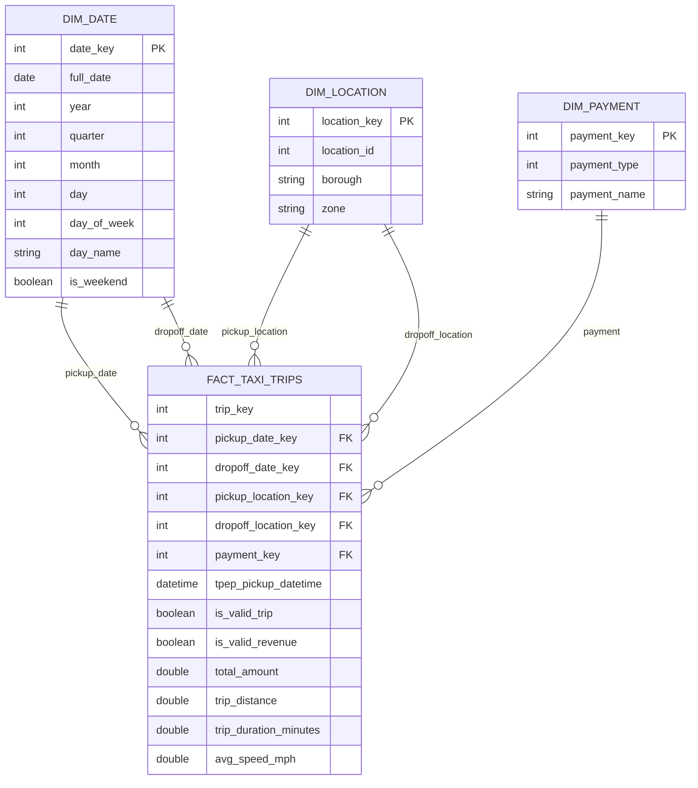

# NYC Taxi Data Factory
# 数据仓库模型设计文档

**Document Version:** 1.0  
**Project:** NYC Taxi Data Factory  
**Data Period:** January 2026 – February 2026  
**Architecture:** Star Schema + Dimensional Data Warehouse  
**Storage Format:** Delta Lake  
**Processing:** Python / Pandas / DuckDB / SQL  

---

# 1. 文档概述（Overview）

## 1.1 项目背景

本项目基于 NYC Yellow Taxi Trip Records，构建一个面向出租车运营数据分析的数据仓库。

项目通过对原始出租车行程数据进行清洗、转换、维度建模和数据聚合，形成结构化的数据仓库，为后续运营分析和商业决策提供支持。

数据仓库采用星型模型（Star Schema），以出租车行程事实表为核心，通过日期、区域和支付方式等维度描述行程数据，并在 DWS 层建立多种分析主题汇总表。

## 1.2 数据范围

| 项目 | 说明 |
|---|---|
| 数据来源 | NYC Yellow Taxi Trip Records |
| 数据分析期间 | 2026-01-01 至 2026-02-28 |
| 时间字段 | tpep_pickup_datetime |
| 分析记录数 | 712,475 |
| 原始 Fact 记录数 | 712,476 |
| 排除记录数 | 1 |
| 有效行程数 | 678,787 |
| 无效行程数 | 33,688 |
| 有效收入 | USD 20,216,180.00 |

分析窗口采用左闭右开区间：

`2026-01-01 <= tpep_pickup_datetime < 2026-03-01`

原始 Fact 表保留全部 712,476 条记录，DWS 构建时按照统一分析窗口筛选数据。

## 1.3 技术架构

- Python：数据处理与 ETL。
- Pandas：数据清洗、转换和聚合。
- Delta Lake：数据表存储及版本管理。
- DuckDB：SQL 查询和数据分析。
- SQL：运营指标分析。
- GitHub：项目代码版本管理。

---

# 2. 数据仓库整体架构（Data Warehouse Architecture）

项目采用分层数据仓库架构。

| 数据层 | 主要职责 | 核心内容 |
|---|---|---|
| Source | 原始数据来源 | NYC Yellow Taxi 数据 |
| DWD | 明细数据层 | 清洗后的行程明细 |
| DIM | 维度数据层 | 日期、区域、支付方式 |
| FACT | 事实数据层 | 出租车行程事实 |
| DWS | 汇总数据层 | 日、小时、区域、支付方式、月度汇总 |
| SQL Analytics | 分析应用层 | 运营指标及商业分析 |

## 2.1 数据流向

```text
NYC Yellow Taxi Raw Data
           |
           v
    Data Cleaning
           |
           v
      DWD Layer
           |
           v
  Data Warehouse Layer
           |
     +-----+------+
     |            |
     v            v
 Dimension      Fact
   Tables       Table
     |            |
     +-----+------+
           |
           v
      DWS Layer
           |
    +------+------+------+-------+
    |      |      |      |       |
    v      v      v      v       v
  Daily  Hourly  Zone Payment Monthly
           |
           v
     SQL Analytics
           |
           v
   Business Insights
```

---

# 3. 星型模型设计（Star Schema Design）

## 3.1 模型设计原则

本项目采用星型模型，以 `fact_taxi_trips` 作为中心事实表，通过外键连接三个维度表：

1. `dim_date`：描述行程日期属性。
2. `dim_location`：描述出租车上车及下车区域。
3. `dim_payment`：描述支付方式。

事实表保存每条出租车行程的详细记录，维度表提供可用于分组、筛选和分析的描述性信息。

## 3.2 星型模型设计图



**说明：** 日期维度和区域维度均采用角色扮演维度（Role-playing Dimension）。

例如，同一个 `dim_date` 分别用于解释上车日期和下车日期；同一个 `dim_location` 分别用于解释上车区域和下车区域。

## 3.3 表之间的关系

| 事实表字段 | 关联维度表 | 维度主键 | 业务含义 |
|---|---|---|---|
| pickup_date_key | dim_date | date_key | 上车日期 |
| dropoff_date_key | dim_date | date_key | 下车日期 |
| pickup_location_key | dim_location | location_key | 上车区域 |
| dropoff_location_key | dim_location | location_key | 下车区域 |
| payment_key | dim_payment | payment_key | 支付方式 |

事实表共包含五个维度外键。

---

# 4. 维度表结构定义（Dimension Tables）

## 4.1 dim_date — 日期维度表

**表名：** `dim_date`

**业务用途：** 提供统一的日期属性，支持日、周、月、季度等时间维度分析。

**粒度：** 一条记录对应一个自然日期。

| 字段名称 | 逻辑类型 | 字段说明 |
|---|---|---|
| date_key | Integer | 日期代理键，主键，格式为 YYYYMMDD |
| full_date | Date | 完整日期 |
| year | Integer | 年份 |
| quarter | Integer | 季度 |
| month | Integer | 月份 |
| day | Integer | 日期中的日 |
| day_of_week | Integer | 星期编号 |
| day_name | String | 星期名称 |
| is_weekend | Boolean | 是否为周末 |

**主键：** `date_key`

**使用场景：**
- 每日行程量分析。
- 工作日与周末对比。
- 月度及季度运营趋势分析。
- 上车与下车时间分析。

## 4.2 dim_location — 区域维度表

**表名：** `dim_location`

**业务用途：** 描述 NYC Taxi 的地理区域信息。

**粒度：** 一个出租车区域对应一条维度记录。

| 字段名称 | 逻辑类型 | 字段说明 |
|---|---|---|
| location_key | Integer | 区域代理键，主键 |
| location_id | Integer | TLC 区域原始编号 |
| borough | String | 所属行政区 |
| zone | String | 具体区域名称 |

**主键：** `location_key`

**数据规模：** 265 条记录。

**使用场景：**
- 不同行政区的行程量分析。
- 热门上车区域排名。
- 区域收入分析。
- 不同区域的行程表现比较。

## 4.3 dim_payment — 支付方式维度表

**表名：** `dim_payment`

**业务用途：** 描述出租车行程的支付方式。

**粒度：** 一种支付类型对应一条维度记录。

| 字段名称 | 逻辑类型 | 字段说明 |
|---|---|---|
| payment_key | Integer | 支付方式代理键，主键 |
| payment_type | Integer | TLC 支付方式编码 |
| payment_name | String | 支付方式描述 |

**主键：** `payment_key`

**数据规模：** 5 条记录。

支付方式映射：

| payment_type | payment_name |
|---:|---|
| 0 | Code 0 - Verify |
| 1 | Credit card |
| 2 | Cash |
| 3 | No charge |
| 4 | Dispute |

---

# 5. 事实表结构定义（Fact Table）

## 5.1 fact_taxi_trips — 出租车行程事实表

**表名：** `fact_taxi_trips`

**业务用途：** 保存出租车行程的详细业务记录，为 DWS 汇总和 SQL 分析提供统一的数据来源。

**粒度（Grain）：** 一条记录代表一条出租车行程。

**数据规模：** 712,476 条记录。

**主键说明：** `trip_key` 为构建阶段生成的代理键，不代表原始数据中的天然订单编号。

### 核心字段定义

| 字段名称 | 逻辑类型 | 字段说明 |
|---|---|---|
| trip_key | Integer | 行程代理键 |
| pickup_date_key | Integer | 上车日期外键 |
| dropoff_date_key | Integer | 下车日期外键 |
| pickup_location_key | Integer | 上车区域外键 |
| dropoff_location_key | Integer | 下车区域外键 |
| payment_key | Integer | 支付方式外键 |
| tpep_pickup_datetime | DateTime | 上车时间 |
| is_valid_trip | Boolean | 行程是否通过有效性判断 |
| is_valid_revenue | Boolean | 收入记录是否有效 |
| total_amount | Numeric | 行程总金额 |
| trip_distance | Numeric | 行程距离 |
| trip_duration_minutes | Numeric | 行程持续时间（分钟） |
| avg_speed_mph | Numeric | 平均行驶速度（英里/小时） |

**注意：** 以上是目前已确认的核心字段，不是 41 个字段的完整清单。完整物理字段、类型及其余字段应以当前 Fact Delta Schema 为准。

### 5.2 事实表指标逻辑

| 指标 | 计算逻辑 | 说明 |
|---|---|---|
| total_trips | 行程记录数量 | 全部分析范围内的记录 |
| valid_trips | SUM(is_valid_trip) | 有效行程数量 |
| invalid_trips | total_trips - valid_trips | 无效行程数量 |
| valid_revenue_usd | SUM(total_amount WHERE is_valid_revenue) | 有效收入总额 |
| avg_speed_mph | 有效行程平均速度 | 用于行程表现分析 |

---

# 6. DWS 汇总层设计（Data Warehouse Summary）

DWS 层以事实表为基础，按照不同业务主题和分析粒度建立汇总表。

项目目前包含五张 DWS 表。

## 6.1 dws_daily_trips — 日度汇总表

**数据粒度：** 日期。

**记录数量：** 59 条。

| 字段名称 | 逻辑类型 | 字段说明 |
|---|---|---|
| date_key | Integer | 日期维度键 |
| full_date | Date | 完整日期 |
| total_trips | Integer | 当日总行程数 |
| valid_trips | Integer | 当日有效行程数 |
| invalid_trips | Integer | 当日无效行程数 |
| valid_revenue_usd | Numeric | 当日有效收入 |
| valid_trip_rate_pct | Numeric | 有效率 |
| invalid_trip_rate_pct | Numeric | 无效率 |
| avg_distance_miles | Numeric | 平均有效行程距离 |
| avg_duration_minutes | Numeric | 平均有效行程时长 |
| avg_speed_mph | Numeric | 平均有效行程速度 |

其余日期描述字段以实际 Delta Schema 为准。

## 6.2 dws_hourly_trips — 小时度汇总表

**数据粒度：** 日期 + 上车小时。

**记录数量：** 1,416 条。

| 字段名称 | 逻辑类型 | 字段说明 |
|---|---|---|
| date_key | Integer | 日期键 |
| pickup_hour | Integer | 上车小时，0–23 |
| full_date | Date | 完整日期 |
| total_trips | Integer | 总行程数 |
| valid_trips | Integer | 有效行程数 |
| invalid_trips | Integer | 无效行程数 |
| valid_revenue_usd | Numeric | 有效收入 |
| avg_distance_miles | Numeric | 平均距离 |
| avg_duration_minutes | Numeric | 平均时长 |
| avg_speed_mph | Numeric | 平均速度 |
| peak_period | String | 高峰时段分类 |

其他日期属性以实际 Delta Schema 为准。

高峰时段定义：

| 时段 | 时间范围 |
|---|---|
| Morning Peak | 07:00–09:59 |
| Evening Peak | 16:00–18:59 |
| Off-Peak | 其他时间 |

## 6.3 dws_zone_trips — 区域汇总表

**数据粒度：** 上车区域。

**记录数量：** 265 条。

| 字段名称 | 逻辑类型 | 字段说明 |
|---|---|---|
| pickup_location_key | Integer | 上车区域维度键 |
| location_id | Integer | TLC 区域编号 |
| borough | String | 所属行政区 |
| zone | String | 区域名称 |
| total_trips | Integer | 总行程数 |
| valid_trips | Integer | 有效行程数 |
| invalid_trips | Integer | 无效行程数 |
| valid_trip_rate_pct | Numeric | 有效率 |
| valid_revenue_usd | Numeric | 有效收入 |
| avg_distance_miles | Numeric | 平均距离 |
| avg_duration_minutes | Numeric | 平均时长 |
| avg_speed_mph | Numeric | 平均速度 |

**使用场景：** 热门区域、行政区收入、区域运营表现分析。

## 6.4 dws_payment_trips — 支付方式汇总表

**数据粒度：** 支付方式。

**记录数量：** 5 条。

| 字段名称 | 逻辑类型 | 字段说明 |
|---|---|---|
| payment_key | Integer | 支付方式代理键 |
| payment_type | Integer | 支付类型编码 |
| payment_method | String | 支付方式名称 |
| total_trips | Integer | 总行程数 |
| valid_trips | Integer | 有效行程数 |
| invalid_trips | Integer | 无效行程数 |
| valid_revenue_trips | Integer | 有效收入记录数 |
| valid_revenue_usd | Numeric | 有效收入 |
| avg_revenue_per_valid_trip_usd | Numeric | 每条有效收入记录的平均收入 |

其他辅助统计字段以实际 Delta Schema 为准。

## 6.5 dws_monthly_trips — 月度汇总表

**数据粒度：** 月份。

**记录数量：** 2 条。

| 字段名称 | 逻辑类型 | 字段说明 |
|---|---|---|
| month_key | Integer | 月份键，YYYYMM |
| year | Integer | 年份 |
| month | Integer | 月份 |
| month_start_date | Date | 月初日期 |
| total_trips | Integer | 总行程数 |
| valid_trips | Integer | 有效行程数 |
| invalid_trips | Integer | 无效行程数 |
| valid_revenue_trips | Integer | 有效收入记录数 |
| valid_revenue_usd | Numeric | 有效收入 |
| avg_distance_miles | Numeric | 平均距离 |
| avg_duration_minutes | Numeric | 平均时长 |
| avg_speed_mph | Numeric | 平均速度 |
| valid_trip_rate_pct | Numeric | 有效率 |
| coverage_status | String | 数据覆盖状态 |
| trips_mom_pct | Numeric | 行程量环比 |
| revenue_mom_pct | Numeric | 收入环比 |

**覆盖状态说明：**

目前两个来源月份均标记为 `coverage_unverified`，表示来源月份已纳入分析，但尚未独立证明完整自然月覆盖。

因此，`trips_mom_pct` 和 `revenue_mom_pct` 暂时保留 NULL，不将未经验证的环比结果作为已确认业务指标。

---

# 7. 数据质量与一致性验证（Data Quality & Validation）

## 7.1 数据质量检查

项目通过 `validate_warehouse.py` 对数据仓库进行统一验收。

主要检查包括：

1. 维度表主键唯一性。
2. 事实表外键完整性。
3. 有效收入记录的金额非空。
4. Fact 基准指标核对。
5. DWS 跨表汇总一致性。
6. DWS 粒度唯一性。
7. 日度与月度汇总一致性。
8. 分析时间范围一致性。

## 7.2 当前验收结果

| 验收指标 | 结果 |
|---|---:|
| 原始 Fact 行数 | 712,476 |
| 分析记录数 | 712,475 |
| 排除记录数 | 1 |
| 有效行程 | 678,787 |
| 无效行程 | 33,688 |
| 有效收入 | $20,216,180.00 |
| Validation Checks | 45/45 |

**最终验收结果：45/45 PASS**

所有已执行的 Warehouse Validation Checks 均通过。

## 7.3 跨表一致性

日度、小时度、区域、支付方式和月度五张 DWS 表均与统一分析范围内的 Fact 基准指标进行核对。

重点验证：

- 总行程数量一致。
- 有效行程数量一致。
- 无效行程数量一致。
- 有效收入总额一致。
- 日度汇总与月度汇总一致。

---

# 8. 数据仓库表清单（Table Inventory）

| 表名 | 表类型 | 粒度 | 记录数 |
|---|---|---|---:|
| dim_date | Dimension | 日期 | 60 |
| dim_location | Dimension | TLC 区域 | 265 |
| dim_payment | Dimension | 支付方式 | 5 |
| fact_taxi_trips | Fact | 单条行程 | 712,476 |
| dws_daily_trips | DWS | 日期 | 59 |
| dws_hourly_trips | DWS | 日期 + 小时 | 1,416 |
| dws_zone_trips | DWS | 上车区域 | 265 |
| dws_payment_trips | DWS | 支付方式 | 5 |
| dws_monthly_trips | DWS | 月份 | 2 |

---

# 9. 总结（Conclusion）

本项目建立了以出租车行程事实表为核心、日期维度、区域维度和支付方式维度为辅助的星型数据仓库模型。

通过构建日度、小时度、区域、支付方式和月度五种 DWS 汇总表，实现了对出租车运营数据的多维度分析。

在数据质量方面，项目采用统一分析时间窗口，保留原始 Fact 数据，并通过跨表指标核对、主外键检查及粒度唯一性检查，确保数据仓库各层之间的一致性。

当前数据仓库已完成 45 项自动化验证，为后续 SQL 分析、运营趋势研究和数据可视化提供了结构化的数据基础。

---

**Document Status:** Version 1.0 – Initial Model Design  
**Schema Note:** 字段清单为当前已确认的核心字段及业务字段。最终物理数据类型、完整字段清单及所有 DWS 辅助字段，应根据当前 Delta Lake Schema 进行逐表核实后定稿。